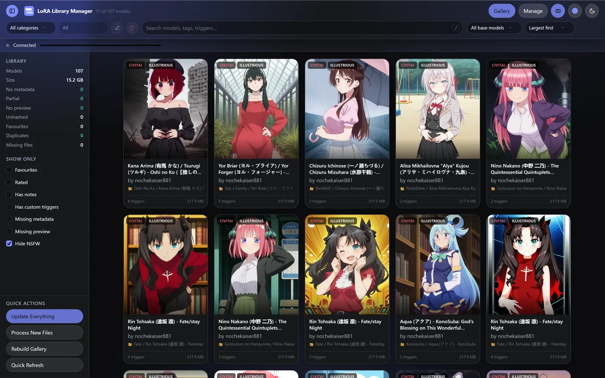
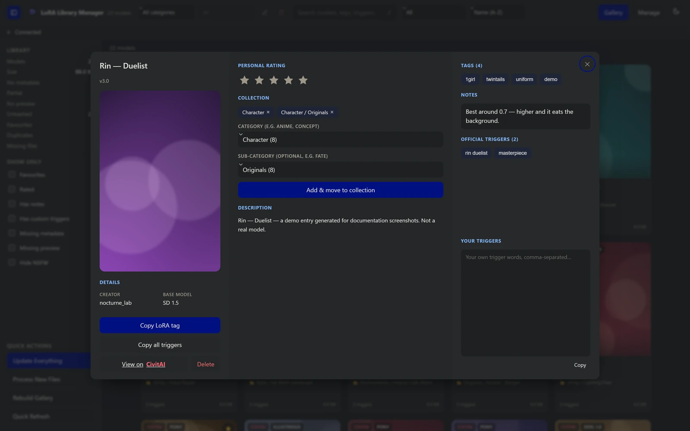
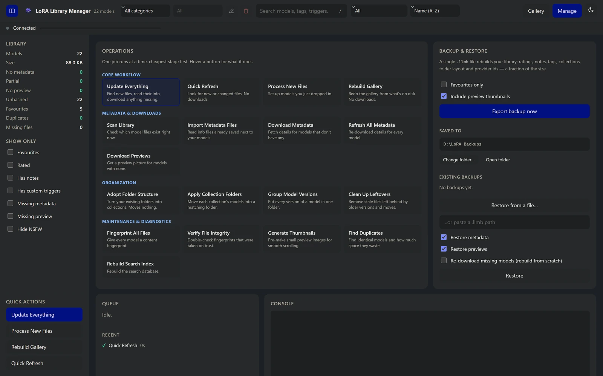
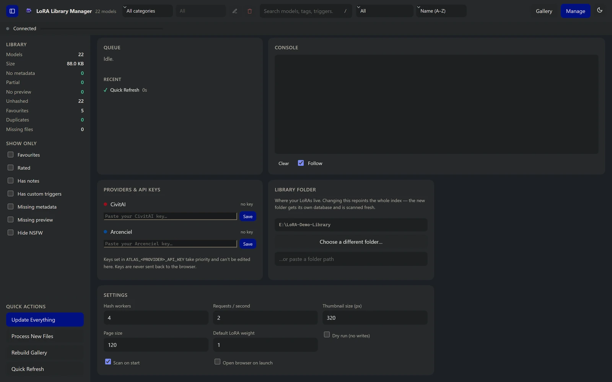

# LoRA Library Manager

A local-first manager for **large** Stable Diffusion LoRA libraries — built around
the assumption that you have 1500+ models, not 50.

It coexists with Forge / AUTOMATIC1111 rather than replacing them: your folder
layout is left alone, sidecar files keep working, and nothing is moved unless
you ask.



*Screenshots are from a real library of 107 models, with "Hide NSFW" on.*

---

## Why this exists

Most LoRA managers treat the filesystem as the database. That works until it
doesn't: every stat, filter and search has to walk the tree and parse every
sidecar, and the gallery is one enormous HTML document with every model inlined.

Atlas separates the two concerns:

- **The filesystem owns the files.** Sidecars are still read and written, so
  your WebUI keeps working.
- **SQLite owns everything derived from them.** Indices and FTS5 answer every
  query the UI makes, with a `LIMIT`.

That single change is what makes the numbers below possible.

---

## Measured on 1500 models

Synthetic library, 1500 models across 420 folders, on Windows 11 / Python 3.10:

| Operation | Time |
|---|---|
| Cold scan (full walk, 1500 models) | **0.31 s** |
| Incremental scan (no changes) | **0.30 s** |
| Read + merge 1000 sidecars (warm) | **0.57 s** |
| `stats()` — full library health | **5 ms** |
| Gallery page (120 rows, joined + counted) | **9 ms** |
| Full-text search across 1500 models | **~90 ms** |
| Search + base-model filter | **15 ms** |
| Database size | **1.5 MB** |

Browser, same library:

| | |
|---|---|
| Models in the library | 1500 |
| Card elements in the DOM | **45** |
| Total DOM nodes | **710** |

The grid is virtualised: cards are a fixed size, so row geometry is arithmetic
and only the visible window plus a small overscan is ever rendered. Scrolling to
the bottom of 1500 models keeps the DOM at the same size.

---

## Getting started

```bash
pip install -r requirements.txt
python run.py
```

That's it. With no arguments Atlas runs a one-time wizard: it searches the
usual Forge / A1111 / ComfyUI locations, shows what it found with model counts
and sizes, and lets you pick or type a path. An API key is optional and it says
so. Then it scans (read-only) and opens the gallery.

Re-run the wizard any time with `python run.py setup`.

### Coming from 2.x

Point Atlas at the same folder. There is no migration step. It reads the
`user_data.json` files 2.x wrote — ratings, notes, personal trigger words,
collections, preferred weight — and imports them on the first scan. Existing
`.civitai.info` and `<stem>.json` sidecars are read too, and nothing is moved
unless you ask.

One on-disk change is worth knowing about. 2.x stored user data per *folder*,
which silently lost data when two versions of a model shared one — whichever you
edited last overwrote the other. Atlas writes `<stem>.user.json` per model
instead, so each version keeps its own rating and notes. The folder-level
`user_data.json` is still kept in step when a folder holds a single model, so
2.x carries on working for the common case; when several versions share a
folder it is left alone rather than being overwritten with one version's data.

Nothing is required beyond the standard library. Pillow is optional — without it
Atlas serves full-size previews instead of thumbnails, which still works but is
much heavier.

## The gallery

The grid is the main view. Each card carries what you need to triage at a
glance: provider and base model, your rating, and small badges for the things
you added yourself — notes, custom tags, personal triggers — plus the folder the
model lives in. The star toggles a favourite without opening anything.

Filtering happens in the top bar, left to right: **category → sub-category →
search → base model → sort**. The category pair drives the same nested
collections your folders map onto, and the pencil and bin beside them rename or
delete a category (the folder on disk follows). The sidebar adds the boolean
cuts — favourites, rated, has notes, has custom triggers, missing metadata,
missing preview, hide NSFW — and a running count of each.

Search is full-text across names, creators, base models, tags, trigger words,
filenames and your own notes. Typing `artist:` followed by a name narrows to one
creator; clicking any artist name on a card does the same thing for you.

Whatever you have narrowed to shows as pills at the front of the search box —
category, sub-category and artist — each with a cross that clears just that one.
The sidebar's show-only checkboxes are remembered between sessions and applied
before the first results are drawn, so a library you always browse with NSFW
hidden opens that way rather than flashing the unfiltered grid first.

### Appearance

Light and dark, and two surfaces: the default solid one, and a transparent mode
that blurs the content moving behind the chrome. Pick the accent from a palette
or a colour well and the whole interface follows it, including the checkboxes
and the ambient wash behind the header. An adaptive option goes further and lets
the artwork of the card you have open drive the tint.

Solid is the default on purpose. Transparency costs frames, and a large library
should get the cheaper surface unless you go looking for the other one.

### The detail view



Click a card for everything about one model. The preview is shown whole rather
than cropped, with a thumbnail strip when there are several images.

Rating, notes, custom tags and your own trigger words are all edited in place
and saved as you type. **Official triggers** from the provider are listed
separately from **your triggers**, so a metadata refresh can never overwrite
what you wrote. Choosing a category and sub-category and pressing *Add & move to
collection* physically moves the model and all its sidecars into a matching
folder. Copy buttons produce a ready-made `<lora:name:weight>` tag or the full
trigger list.

## The Manage page



Every operation is a button with a plain-language description — no jargon, and
hovering explains what it will touch. They are grouped by what they are for:
core workflow, metadata and downloads, organisation, and maintenance. One job
runs at a time, cheapest stage first, and anything long-running can be cancelled
from the status strip.

**Backup & restore** lives on the same page. Export writes a single `.llmb`
file, optionally favourites-only and with or without preview thumbnails.
Restore reads one back, with separate switches for metadata, previews, and
re-downloading model files that are missing locally.



Below that: the job queue, a live console streamed over SSE, API-key entry for
each provider, a library-folder picker, and the tuning settings — hash workers,
requests per second, thumbnail size, page size, default LoRA weight, and a dry
run switch that makes every operation report what it would do without writing.

## The command line

Everything above is also a command. The CLI and the web UI are two front ends
over the same code — not two implementations.

```bash
python run.py init "Put default Lora location here"
python run.py sync
python run.py serve
```

`serve` prints a URL containing a session token and opens it. Other commands:

```bash
python run.py stats                 # library health
python run.py search "rin tohsaka"  # full-text search
python run.py duplicates            # content-identical files
python run.py hash                  # hash everything (needed for dedupe/backup)
python run.py backup export
python run.py backup restore <file>
python run.py doctor                # check the environment
```

---

## API keys

Read from the environment first:

```bash
setx ATLAS_CIVITAI_API_KEY   "your-key"     # Windows
export ATLAS_CIVITAI_API_KEY="your-key"     # bash
```

`atlas.json` is a fallback for convenience. Either way, **no endpoint ever
returns a key**. The API reports only whether one is configured and where it
came from (`env` / `file` / `unset`), and `config.public_settings()` enforces
that centrally so a newly added setting cannot leak by being put in the wrong
dictionary. A test asserts it.

---

## Security posture

The dashboard can trigger destructive jobs and reaches your whole library, so
the defaults are deliberate:

| | |
|---|---|
| Bind address | `127.0.0.1` only, never `0.0.0.0` |
| Auth | Session token minted per run; `HttpOnly`, `SameSite=Strict` cookie |
| `Host` header | Validated against a loopback allowlist — this is what stops DNS rebinding |
| CORS | No headers, no `OPTIONS` handler, so no other origin can read a response |
| CSP | `default-src 'none'`; everything is self-hosted, no CDN |
| Media paths | Resolved and containment-checked against the library root |
| Download URLs | Key travels in an `Authorization` header, never `?token=` |

Verified against a running server: unauthenticated API → `401`; forged `Host` →
`421`; CORS preflight → `501`; traversal attempts (raw, URL-encoded, backslash,
absolute) → all refused.

---

## Collections as real folders

Collections are queryable on their own, but you can also make them physical:

```bash
python run.py organise --preview   # show every move, change nothing
python run.py organise             # asks for confirmation first
python run.py cleanup --delete     # remove leftovers afterwards
```

A model and *all* its assets — sidecars, previews, `<stem>.user.json` — move as
one unit. Nothing is ever overwritten (collisions get a numeric suffix),
folders emptied by the move are removed, and versions of the same model land in
the same folder. `dry_run` mode short-circuits the apply.

Measured on a real 24-model library: 24 models moved, 96 files, 0 content
hashes lost, 0 empty folders left, 6 stranded sidecars detected and removed.

## The .llmb backup

One file rebuilds the library. It stores what cannot be re-downloaded — ratings,
notes, personal triggers, custom tags, collections, folder paths, provider and
version ids, SHA-256 — plus preview *thumbnails* rather than originals.

Measured: a **2,902 MB library exported to a 751 KB `.llmb` — 0.025%**. Restore
matched all 24 models by hash and rebuilt every rating, note, tag, collection
and membership. Models the archive knows about but that are absent locally are
listed with their provider and version id so they can be re-fetched.

Restore is a union, never a replacement: it cannot remove a tag or trigger you
added after the export.

## Your existing folder structure

If you have spent years arranging LoRAs into `Anime/Fate/Rin/`, that tree *is*
metadata. Atlas never moves a file — it mirrors the hierarchy you already have
as nested collections, so the structure becomes filterable while the folders
stay put.

```bash
python run.py folders analyse    # report only, changes nothing
python run.py folders preview    # exactly what would be created
python run.py folders adopt      # apply it
```

Filtering by a parent finds everything beneath it — `Anime` returns models in
`Anime/Fate/Rin` too. Noise folders (`unsorted`, `new`, `tmp`, …) are skipped,
re-running is idempotent, and members you added by hand are never pruned unless
you pass `--prune`.

## Your curated metadata is never overwritten

If you have been hand-writing trigger words and notes in the WebUI for years,
that is the one thing a manager cannot regenerate. Atlas treats it accordingly:

- Hand-curated `activation text` and `notes` from `<stem>.json` are **adopted
  into Atlas's own user data** on first scan, where no metadata refresh can
  reach them. Official provider triggers are stored separately.
- Writing a sidecar **unions** trigger words — your entries keep their position,
  official ones are appended. Nothing is ever removed from that file.
- A curated `preferred weight`, `negative text` or `description` is never
  replaced by a provider value; those only fill gaps.
- Unknown keys written by other tools are read back and re-emitted untouched.

There are regression tests for exactly this: a provider resolve returning
entirely different trigger words must leave your curated ones intact, in the
database and on disk.

## Design notes

**Hashing is lazy.** 1500 LoRAs is comfortably 300 GB. Change detection uses
`(size, mtime)`; SHA-256 is only computed when something actually needs one — a
provider lookup, a duplicate sweep, or a backup. Results are cached and
invalidated by the scanner. Smallest files hash first, so a cancel still banks
progress.

**User data is keyed by content hash, not path.** Ratings, notes, collections
and personal triggers live in their own table and are archived by SHA-256 when a
file disappears, so renaming or reorganising your library cannot cost you them.
There is a test for exactly this.

**Sidecar writes are merge-preserving.** Unknown keys written by another tool
are read back and re-emitted untouched, and the lenient parser repairs trailing
commas, missing commas and truncated files rather than discarding them.

**One scan, not three.** The scanner does one `os.scandir` per directory and
matches models to their sibling previews and sidecars in memory, then records
which sidecars exist so enrichment never re-probes the filesystem.

**No polling.** A single SSE stream carries jobs, stats and logs. The UI is a
function of pushed state. Job progress is coalesced to ~5 frames/second, because
a hash pass emits thousands of ticks a second and serialising them all would
cost more than the hashing.

**Themes are tokens only.** Components consume `var(--panel)` and never a
literal colour; switching theme redefines the tokens and nothing else. There are
no per-component theme overrides, so a new component cannot ship half-themed.

---

## Layout

```
run.py                  CLI entry point
atlas/
  config.py             settings; env-first secrets
  db.py                 SQLite schema, WAL, FTS5 maintenance
  scanner.py            single-pass filesystem discovery
  hashing.py            lazy, cached, parallel SHA-256
  sidecar.py            lenient JSON, WebUI compatibility, atomic writes
  enrich.py             sidecars -> providers -> previews
  query.py              all read queries; every one has a LIMIT
  thumbnails.py         content-addressed WebP cache
  jobs.py               priority queue, cancellation, progress
  events.py             pub/sub behind the SSE stream
  tasks.py              runnable operations and pipelines
  organizer.py          move planning, collision-safe apply, orphan sweep
  folders.py            existing folder tree -> nested collections
  backup.py             .llmb export/restore, optional re-download
  onboarding.py         first-run wizard and library discovery
  api.py                JSON handlers and the route table
  server.py             HTTP, auth, static and media serving
  providers/            base contract, registry, CivitAI, Arcenciel
  static/               index.html, app.css, app.js
tests/test_atlas.py     122 tests
docs/                   README screenshots
```

## Tests

```bash
python -m unittest discover -s tests -v
```

122 tests, no network access, each against a throwaway library.

---

## Status — what is and is not here

Compared with 2.x:

**Present, and stronger:** incremental indexing, smart refresh, duplicate
detection, missing-asset detection, WebUI sidecar compatibility, lenient sidecar
repair, search, base-model / creator / collection filtering, sorting,
favourites, ratings, notes, personal trigger words and trigger groups, trigger
copying, collection editing and category rename/delete from the gallery,
per-version user data, multi-image previews, the live dashboard (SSE logs,
health, sync triggers, settings), backup export/restore including re-download of
missing models, and folder structure adoption.

**Not built yet:**

| Feature | Note |
|---|---|
| Prompt builder | Not started |
| Automatic file organisation | Deliberate — it adopts your layout instead of imposing one |
| Hover preview on cards | The detail view has the full image and a thumbnail strip |
| Standalone model downloading | Wired for backup restore only; no "download this model" button |

**Changed on purpose:** the gallery is a fixed-size grid rather than masonry.
Variable card heights make row geometry non-arithmetic, which is what makes
virtualisation cheap — and virtualisation is what keeps 1500 models at 45 DOM
nodes.

**Provider status:** both clients have been exercised against the live services.
CivitAI follows the documented v1 API. Arcenciel has no by-hash lookup, so
resolution goes through its search endpoint and its own field names
(`title`, `activationTags`, `uploader.username`) — the client was rewritten
against real responses rather than assumed ones. Neither is covered by the test
suite, which makes no network calls at all.

## Licence and attribution

MIT — see [LICENSE](LICENSE). Use it, change it, ship it, sell it. The one
binding condition is that the copyright notice and the licence text travel
with any copy or substantial portion of the code.

Beyond that, a request rather than a requirement: **if you fork this, build on
it, or share a modified version, please link back to
https://github.com/DXDavisXD/Lora-Library-Manager and say what you changed.**
No licence can compel a link, so this is asked in good faith — it costs you a
line and it means people can find the original and the history behind it.
